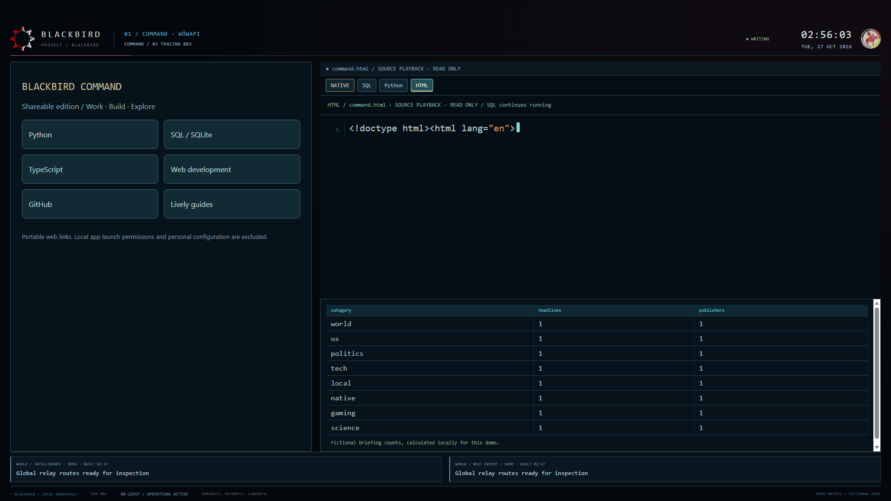
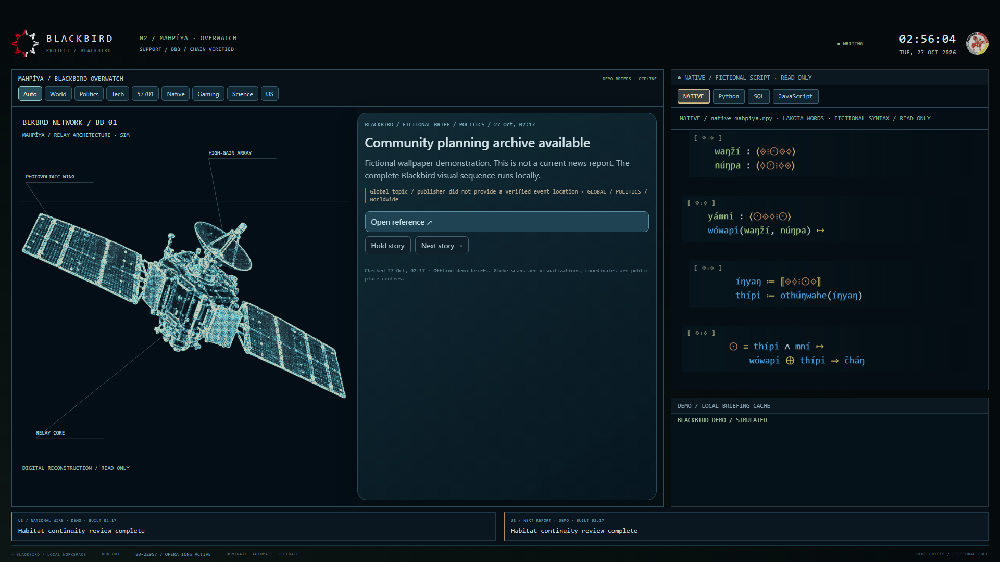
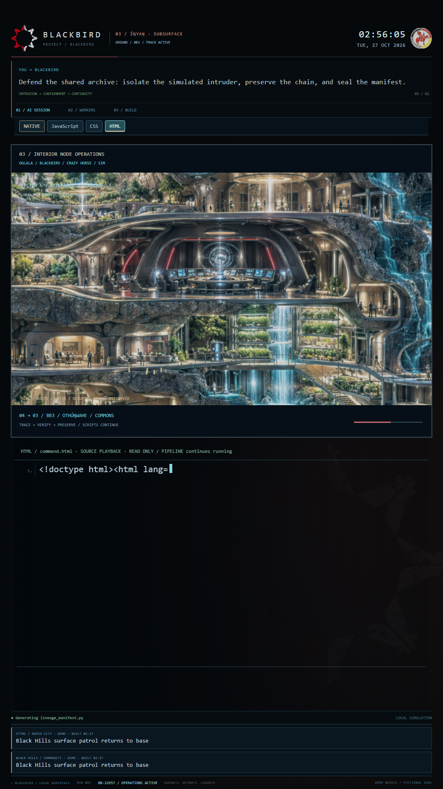
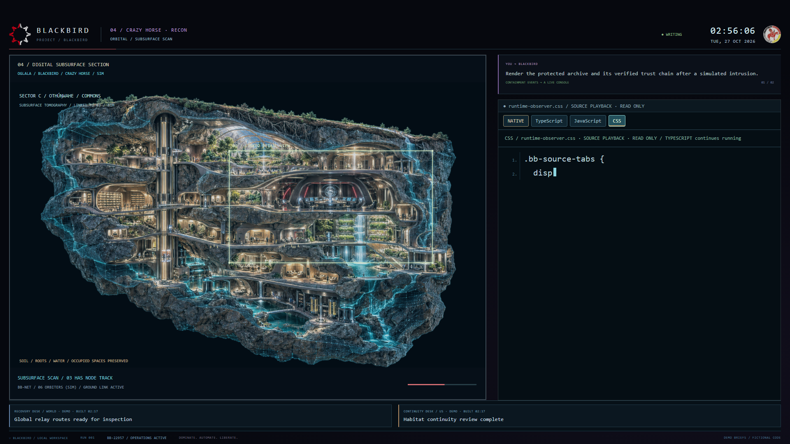

# BLACKBIRD — Community Edition

Four coordinated animated wallpapers for Windows and Lively Wallpaper, created for Blackbird / **cs-blackbird**. A fictional future inspired by Oglala/Lakota identity: mountain reconnaissance, a hidden underground complex, orbital overwatch and a command center, with colorful running code.

**Use any 1, 2, 3, or all 4 wallpapers. You do not need four monitors.** Pick the designs you like and assign them in Lively; each works on its own.

## Download and install

**[Download the latest wallpaper bundle](https://github.com/cs-blackbird/blackbird-wallpapers/releases/latest)**

1. Install [Lively Wallpaper](https://www.livelywallpaper.net/).
2. Download `Blackbird-Community-Edition-v1.zip` from the release's **Assets**.
3. Extract that outer ZIP. Inside its `Packages` folder are four numbered wallpaper ZIPs.
4. Drag the numbered ZIPs into Lively's library and assign them to your displays.

| Wallpaper | Role | Layout |
| --- | --- | --- |
| 1 — Command | Command center and SQL-inspired display | Landscape |
| 2 — Overwatch | Globe, satellite network and briefing panels | Landscape |
| 3 — Security | Detailed scans and code | Portrait |
| 4 — Mountain Recon | Monument, village and underground scan handoff | Landscape |

Use all four or select the ones that fit your setup. Displays 3 and 4 coordinate through the same system clock; neither requires the other to be present. Keep computer clocks aligned if using different PCs.

## What moves

- Code tabs randomly choose another available language after each completed script, independently on each display, without immediately repeating the current tab.
- Manual code-tab buttons remain available.
- NATIVE blends written Lakota word identifiers with fictional program syntax. It is an artistic code display, not a real programming language or a Lakota grammar lesson.
- Mountain views, underground scans, simulated people and the BLKBRD satellite network follow a coordinated visual story.

## Previews

These are screenshots of the running community wallpapers, without desktop icons, browser controls or control-session banners.

## Know before using

The news tiles in this edition contain **fictional offline DEMO briefings**, not live headlines. Command buttons open portable web links rather than the creator's local applications. All sensor readings, scans and surveillance activity are simulations. Monument angles are artist-imagined views rather than a continuous 3D reconstruction.

The community edition replaces personal details with fictional identifiers and does not require the creator's local services. No Windows settings are changed by importing these wallpapers.

See [LANGUAGE-NOTES.md](LANGUAGE-NOTES.md) for language context and sources. The original Lively metadata specifies personal use; no additional open-source or commercial license is granted here. Contact cs-blackbird about other uses.

## Sharing

Share this repository or its release link. The release bundle includes the four importable packages and their SHA-256 checksums.
